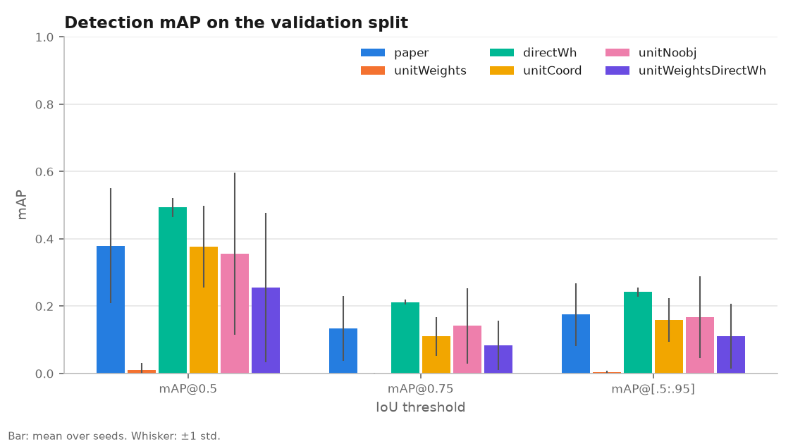
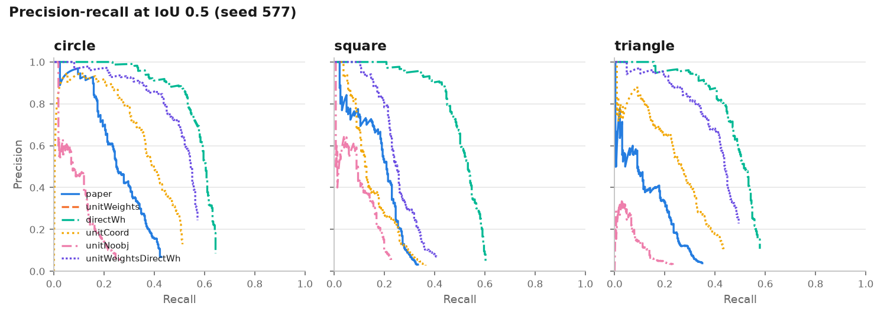
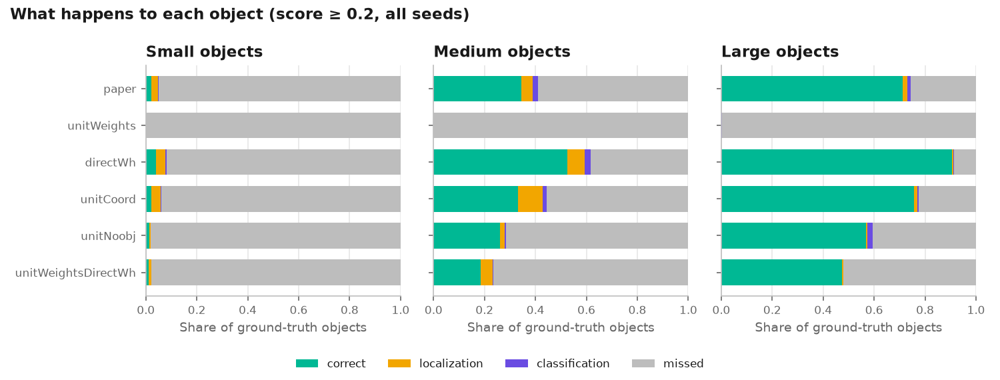
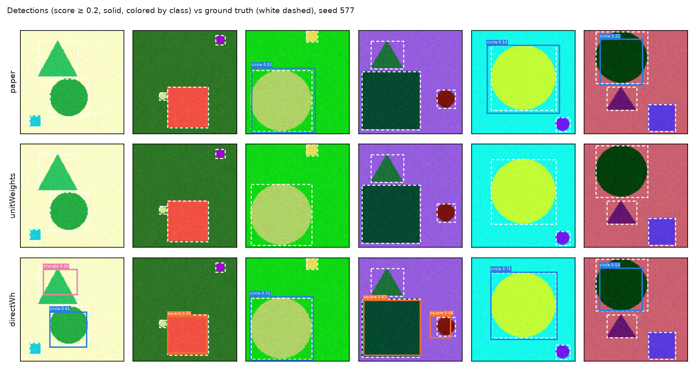

# Evaluation and experimental analysis

Abdul Mueed Mohammed, CS 577 team Pre-formed-A.

This evaluates the final checkpoints of Omar's loss ablations ([lossAblations.md](lossAblations.md)) as detectors. Omar's study already reports the proposal's main metric, the mean IoU of the responsible box. Here we add the standard detection metrics and look at where each loss fails:

- mAP at IoU 0.5, 0.75 and averaged over 0.5:0.95
- per-class AP and precision-recall curves
- what happens to each ground-truth object, split by object size
- example detections

**Short answer:**

- **Equal weights break detection outright, not just IoU.** `unitWeights` has mAP@0.5 = 0.011, against 0.380 for `paper`.
- **Dropping the square root did not hurt on our task.** `directWh` has the highest mAP at every IoU threshold (0.493 at 0.5) and the smallest spread across seeds.
- **Most failures are low confidence, not bad boxes.** At the 0.2 score threshold, 65% of objects get no detection with the paper loss. At 0.01 only 20% are truly missed.
- **Small objects are where every loss fails.** Even at a 0.01 threshold, about 40% of small objects (< 24 px) get a box with IoU below 0.5. This is the case `√w, √h` is meant to fix, and it does not fix it here.

## Reproduction check

The 18 ablation runs (6 variants × seeds 577, 1, 2 × 30 epochs) were retrained from scratch on a different machine (macOS arm64, torch 2.15, CPU) with Omar's command. All 18 rows of `runSummary.csv` match Omar's committed table exactly, apart from floating-point rounding (largest difference about 1e-15). Only the timing columns differ. The ablation results are therefore deterministic and reproducible from the repository.

## Method

| | |
|---|---|
| Checkpoints | `last.pt` (epoch 30) of every ablation run. `best.pt` is chosen by each variant's own loss, which is on a different scale per variant, so it is not a fair pick. |
| Data | The validation split of each run's seed: 500 images and about 990 objects per seed, 2,972 objects in total |
| Detections | Class score = confidence × class probability (paper, Section 2). Best class per box, class-wise NMS at IoU 0.5. |
| AP | PASCAL VOC all-point interpolation. All detections with score ≥ 0.01 are ranked. A duplicate detection of an already matched object counts as a false positive. mAP is the mean over the 3 classes. |
| mAP@[.5:.95] | Mean of mAP over IoU thresholds 0.50, 0.55, …, 0.95 (COCO style). It rewards tight boxes. |
| Operating point | Score ≥ 0.2, the same threshold as Omar's recall and precision |
| Error breakdown | Each object gets the best outcome among the operating-point detections: **correct** (right class, IoU ≥ 0.5), **localization** (right class, 0.1 ≤ IoU < 0.5), **classification** (wrong class, IoU ≥ 0.5) or **missed** |
| Size buckets | √(w·h) in pixels: small < 24, medium 24-48, large ≥ 48 (same as Omar's) |

Values are mean ± std over the three seeds. Differences are paired by seed against `paper`.

## Results

Full tables: [evaluationResults/summary.md](evaluationResults/summary.md). Per-run values: [runMetrics.csv](evaluationResults/runMetrics.csv), [errorBreakdown.csv](evaluationResults/errorBreakdown.csv).

| Variant | mAP@0.5 ↑ | mAP@0.75 ↑ | mAP@[.5:.95] ↑ | Δ mAP@0.5 vs paper (seeds ≥ paper) |
|---|---|---|---|---|
| `paper` | 0.380 ± 0.170 | 0.133 ± 0.096 | 0.175 ± 0.093 | — |
| `unitWeights` | 0.011 ± 0.020 | 0.001 ± 0.001 | 0.003 ± 0.005 | −0.369 (0/3) |
| `directWh` | 0.493 ± 0.029 | 0.212 ± 0.008 | 0.242 ± 0.014 | +0.113 (2/3) |
| `unitCoord` | 0.377 ± 0.121 | 0.110 ± 0.057 | 0.159 ± 0.064 | −0.003 (2/3) |
| `unitNoobj` | 0.356 ± 0.241 | 0.142 ± 0.112 | 0.167 ± 0.121 | −0.024 (1/3) |
| `unitWeightsDirectWh` | 0.256 ± 0.222 | 0.083 ± 0.073 | 0.111 ± 0.096 | −0.124 (1/3) |



### 1. mAP agrees with the IoU results, with larger gaps

The ranking matches Omar's mean-IoU ranking, but the differences are much larger. `paper` and `directWh` differ by only 0.016 in responsible-box IoU, yet by 0.113 in mAP@0.5. The reason is that mAP also depends on confidence. A box is only a useful detection if its score ranks it above the false positives, and `directWh`'s confidences are higher at the 0.2 threshold (recall 0.425 vs 0.306) and much more consistent across seeds.

The paper loss is also very sensitive to the seed: mAP@0.5 is 0.523, 0.424 and 0.192 on seeds 1, 2 and 577. The seed-577 run is the one Omar notes escaped the loss plateau late, and its confidences are low. Its responsible-box IoU (0.507) looks acceptable, but mAP shows that it barely detects anything at the 0.2 threshold.



The precision-recall curves are for seed 577, the baseline seed. On this seed `paper` is its worst run, so its curves here are weaker than its average. `directWh` reaches the highest recall on all three classes. `unitWeights` has no curve because it produces almost no detections above 0.01.

### 2. Where the failures come from



At the operating point (score ≥ 0.2), "missed" dominates for every variant: 65% of objects with `paper` and 53% with `directWh`. Lowering the threshold to 0.01 shows what those misses are:

| Variant | Threshold | Correct | Localization | Missed | Small: correct | Small: localization | Small: missed |
|---|---|---|---|---|---|---|---|
| `paper` | 0.2 | 30.6% | 3.1% | 65.1% | 2.1% | 2.6% | 95.0% |
| `paper` | 0.01 | 51.7% | 26.9% | 19.7% | 11.6% | 40.6% | 45.2% |
| `directWh` | 0.2 | 42.4% | 3.9% | 52.6% | 4.0% | 3.7% | 91.8% |
| `directWh` | 0.01 | 58.5% | 24.5% | 15.2% | 16.7% | 44.3% | 35.9% |

(All seeds pooled. Classification errors are about 1% everywhere and are left out of this table.)

- **Most "missed" objects are found, but with low scores.** At 0.01, missed objects fall from 65% to 20% for `paper`. The loss trains the confidence toward the predicted box's IoU, which is about 0.5-0.6 here, and the class probability multiplies it further. So a correct box often scores below 0.2. This is a property of YOLOv1's confidence target, not of the λ or square-root choices.
- **The localization errors are real.** About a quarter of all objects, and over 40% of small ones, get a right-class box with IoU between 0.1 and 0.5.
- **Small objects fail under every loss.** Under 17% of small objects are ever detected correctly, against 71% (`paper`) and 91% (`directWh`) of large ones at the 0.2 threshold. This matches the limitation the YOLOv1 paper itself states (Section 2.4): coarse grid features and only 2 boxes per cell make small objects hard. On our 7×7 grid each cell is 16 px wide, and small objects are 8-24 px.
- **The square root does not rescue small objects.** The paper's argument for `√w, √h` is that it makes a given pixel error count more on small boxes. If that helped, `paper` should beat `directWh` on small-object localization. It does not: `directWh` is at least as good on small objects at both thresholds (correct 16.7% vs 11.6% at 0.01).

### 3. Example detections



The same six validation images (seed 577) for the proposal's three losses:

- **`unitWeights` outputs nothing above 0.2.** This is the saturated-confidence collapse Omar describes.
- **`paper` finds the large circles and misses the rest at 0.2.**
- **`directWh` also finds the large squares and some medium shapes.** It still misses every small shape, and on the first image it gives the triangle a loose box (localization error).

## Conclusions

1. **The loss weights matter for detection.** With both weights set to 1, mAP drops to about 0 on all three seeds. Detection quality confirms Omar's IoU result, and the effect is larger on mAP.
2. **The square root gives no benefit on our task, including for small objects.** Regressing `w, h` directly gives the best mAP and the most stable runs. Small objects are badly localized under both parameterizations. The bottleneck on this task is grid resolution and model capacity, not how the size error is weighted.
3. **Low recall is mostly a calibration effect.** It comes from YOLOv1's IoU-valued confidence target multiplied by the class probability, so fixed score thresholds like 0.2 understate what the model finds. mAP is the better summary for comparing losses, because it does not depend on a threshold.

## Caveats

- Three seeds with a large spread for `paper` (mAP@0.5 from 0.19 to 0.52). Only differences consistent across seeds should be trusted. See the "seeds ≥ paper" counts.
- Synthetic shapes on a 112×112 image with a 7×7 grid. These conclusions are about this setting, not VOC.
- Error categories follow the spirit of Hoiem et al. (2012) but are simplified: there is no "similar class" or "background" split for false positives.
- The precision-recall figure shows one seed. Per-seed curves for every run are in `results/evaluation/precisionRecall.json`, which is created when you run the evaluation and is not committed because it is 4 MB.

## Reproduce

```bash
python scripts/runAblations.py --seeds 577 1 2 --jobs 5 --threads 2 --set device=cpu   # ~37 min on 10 cores
python scripts/evaluateCheckpoints.py --ablations --figureDir docs/figures/evaluation    # ~1 min
cp results/evaluation/{summary.md,runMetrics.csv,errorBreakdown.csv} docs/evaluationResults/
```

To evaluate any single checkpoint (prints JSON):

```bash
python scripts/evaluateCheckpoints.py --checkpoint checkpoints/baseline/last.pt
```

Code: [src/evaluation/detectionMetrics.py](../src/evaluation/detectionMetrics.py) (AP, PR curves, error breakdown), [src/evaluation/evaluate.py](../src/evaluation/evaluate.py) (checkpoint evaluation, tables, CLI), [src/evaluation/figures.py](../src/evaluation/figures.py). Tests: [tests/testEvaluation.py](../tests/testEvaluation.py), 7 tests, including a hand-computed AP of 5/6.
