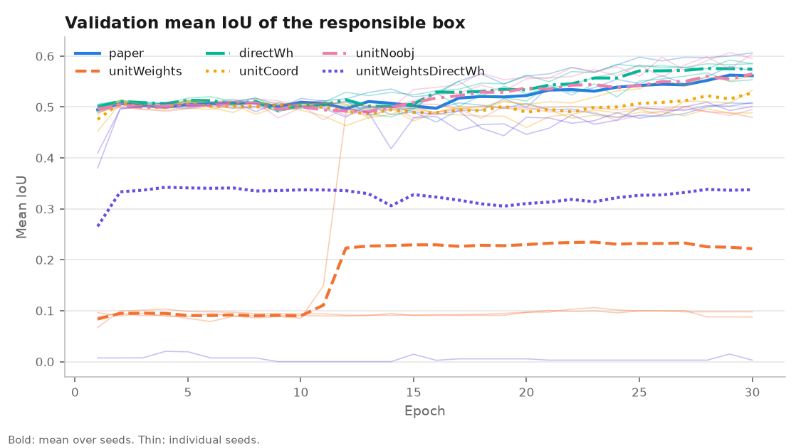
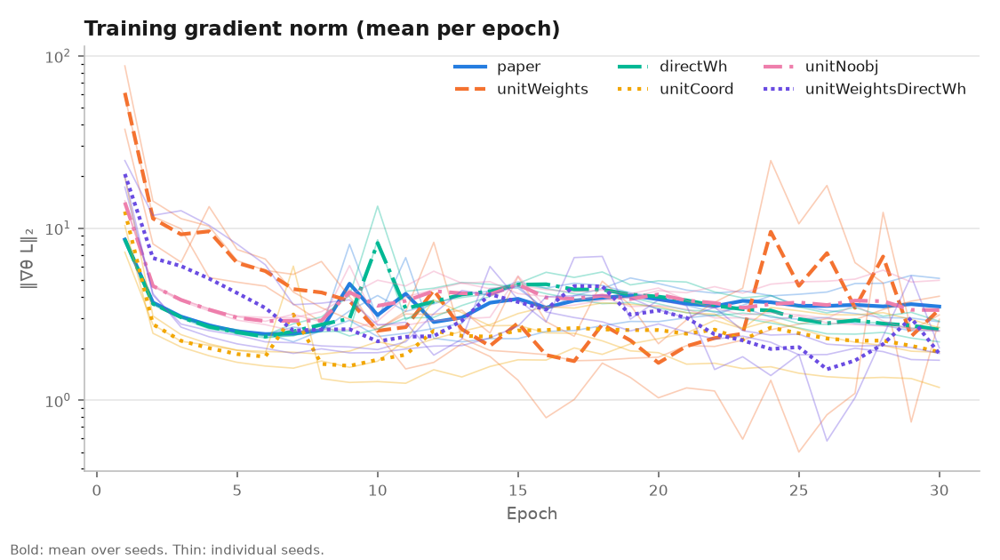
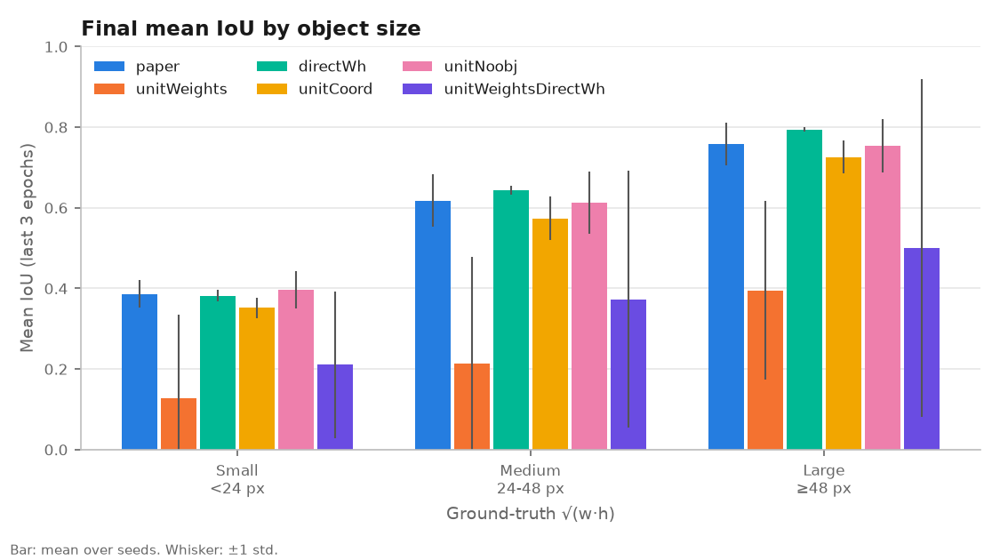

# Loss-function ablations

Omar Ashurbayov, CS 577 team Pre-formed-A.

The proposal (Section 4) asks whether YOLOv1's two loss design choices matter:

- the weights `λcoord = 5` and `λnoobj = 0.5`
- regressing `√w`, `√h` instead of `w`, `h`

We trained the paper loss and five ablated losses on the synthetic shapes task with three seeds each, keeping everything else fixed.

**Short answer:**

- **The weights matter, as the paper says.** Setting both to 1 broke training on every seed.
- **The square root did not help on our task.** Regressing `w`, `h` directly was as good or slightly better, including on small objects.

## Setup

| | |
|---|---|
| Data | Synthetic shapes, 2,000 train / 500 val, 112×112, 1-3 objects of 8-80 px |
| Model | Danish's 4-conv + 2-FC YOLOv1-style model, sigmoid head, 3.64M parameters |
| Training | Adam, lr 1e-3, batch 32, 30 epochs, no weight decay, no clipping |
| Seeds | 577, 1, 2. A seed fixes the data split, initialization and shuffle order. Every variant uses the same three seeds, so comparisons are paired by seed. |
| Compute | CPU, 6 runs in parallel, about 9.4 s per epoch, 15 minutes for all 18 runs |

Only `loss.*` differs between runs with the same seed. `assertFairComparison` checks this before any training starts.

| Variant | λcoord | λnoobj | √w, √h | Role |
|---|---|---|---|---|
| `paper` | 5 | 0.5 | yes | reference |
| `unitWeights` | 1 | 1 | yes | proposal ablation 1 |
| `directWh` | 5 | 0.5 | no | proposal ablation 2 |
| `unitCoord` | 1 | 0.5 | yes | which weight matters? |
| `unitNoobj` | 5 | 1 | yes | which weight matters? |
| `unitWeightsDirectWh` | 1 | 1 | no | both ablations at once |

**Metrics.** These are logged every epoch through the `extraMetricsFn` hook in `train()`:

- **Main metric:** validation mean IoU of the responsible box, as in the proposal.
- **IoU by object size:** small means √(w·h) < 24 px, medium is 24-48 px, large is ≥ 48 px. This split tests the square-root claim directly.
- **Recall and precision at IoU 0.5**, after NMS with score ≥ 0.2.
- **Validation loss under the paper's weights**, computed for every variant. Each variant's own loss is on a different scale, so this gives a common yardstick.
- **Gradient norm of each loss term** on a fixed batch of 64 validation images.
- **Training gradient norm** at every optimizer step.

**Reported values.** Headline numbers are the mean over the last 3 epochs of a run, then mean ± std over the three seeds.

## Results

Full tables: [lossAblationResults/summary.md](lossAblationResults/summary.md). Per-run numbers: [runSummary.csv](lossAblationResults/runSummary.csv).

| Variant | Mean IoU ↑ | IoU small ↑ | IoU large ↑ | Recall@0.5 ↑ | Δ IoU vs paper (seeds ≥ paper) |
|---|---|---|---|---|---|
| `paper` | 0.559 ± 0.049 | 0.386 ± 0.034 | 0.758 ± 0.052 | 0.286 ± 0.190 | — |
| `unitWeights` | 0.224 ± 0.227 | 0.127 ± 0.207 | 0.395 ± 0.222 | 0.000 ± 0.000 | −0.335 (0/3) |
| `directWh` | 0.575 ± 0.016 | 0.382 ± 0.014 | 0.794 ± 0.005 | 0.427 ± 0.024 | +0.016 (1/3) |
| `unitCoord` | 0.522 ± 0.033 | 0.352 ± 0.026 | 0.726 ± 0.040 | 0.295 ± 0.131 | −0.037 (0/3) |
| `unitNoobj` | 0.560 ± 0.061 | 0.397 ± 0.047 | 0.753 ± 0.066 | 0.234 ± 0.192 | +0.001 (1/3) |
| `unitWeightsDirectWh` | 0.337 ± 0.286 | 0.211 ± 0.182 | 0.501 ± 0.419 | 0.175 ± 0.151 | −0.221 (0/3) |



### 1. Unit weights: training collapses

`unitWeights` failed on all three seeds:

- **Seeds 577 and 1:** stuck at IoU ≈ 0.09 for all 30 epochs.
- **Seed 2:** also stuck until epoch 11, then recovered to the level of the paper loss (0.48).
- **`unitWeightsDirectWh`:** collapsed the same way on seed 1 (IoU 0.003).

The paper loss never collapsed.

The logs show how the collapse happens:

1. **Epoch 1:** the peak training gradient norm reaches 1,470-2,479, against about 30 for `paper`.
2. **Right after that spike:**
   - every confidence output is pushed to 0, so the validation no-object term is 0.0000 and recall is 0
   - the box outputs freeze at wrong values (relative size error of about 4 on small objects)
3. **The gradients of every loss term on the probe batch then drop to roughly 0.** The sigmoid head is saturated, so no term can pull it back.
4. **Seed 2 escaped this state; the other two never did.**

**Neither weight alone causes this:**

- **`unitNoobj` matches the paper:** IoU +0.001, no collapse.
- **`unitCoord` is consistently a little worse:** IoU −0.037, lower on all 3 seeds, but it never collapses.

The failure comes from changing the ratio λcoord/λnoobj from 10 to 1. With that ratio, the confidence terms from the 98 predictors per image dominate the gradient from the few boxes that contain objects. This is the mechanism the paper describes.

Even with the paper's weights, the no-object gradient is about twice the object-confidence gradient in epoch 1 (norm ratio 1.93 ± 0.30). With `λnoobj = 1` it is 2.70 ± 0.11. Down-weighting the empty cells is therefore not cosmetic, even at λnoobj = 0.5.



### 2. Square root of w, h: no benefit on this task

The paper argues that `√w`, `√h` makes a given pixel error cost more on a small box than on a large one, which should help small objects. We did not see that:

- **Small objects:** `directWh` and `paper` are tied on IoU (0.382 vs 0.386, Δ −0.004). `directWh` has a slightly lower relative size error (0.414 vs 0.460).
- **Large objects:** `directWh` is better on all 3 seeds (+0.036 IoU).
- **Recall@0.5:** `directWh` is better on all 3 seeds (0.427 vs 0.286).
- **Overall mean IoU:** the difference is +0.016 but not consistent (1 of 3 seeds ≥ paper), so it should be treated as no difference.
- **Stability:** `directWh` was also the most stable variant across seeds (IoU std 0.016 vs 0.049).



Possible reasons the square root does not help here. These are hypotheses we have not tested:

- **The sigmoid head bounds `w`, `h` to (0, 1).** Large raw errors on big boxes cannot happen, so there is less for the square root to correct.
- **Adam rescales each parameter's update.** That reduces the effect of how the loss scales errors.
- **Box sizes span only a 10× range (8-80 px).** The paper's VOC boxes span a much wider range.

## Conclusions

1. **The loss weights matter.** Setting both weights to 1 breaks training, and the logs show the cause: confidence and coordinate gradients are out of balance. The paper's motivation holds. The specific value of λnoobj matters less (0.5 vs 1 makes no difference) than keeping the coordinate weight well above the no-object weight.
2. **The square-root parameterization is not needed on our synthetic task,** and it slightly hurts large-box localization. This matches the proposal's second scenario ("the choices matter less on our simplified task"). It should not be read as evidence against the paper on VOC.

## Caveats

- **Three seeds and large seed-to-seed spread.** For example, `paper` IoU ranges from 0.51 to 0.61. Small differences (under about 0.03) are not meaningful. The "seeds ≥ paper" counts show how consistent each effect is.
- **The model sits on a loss plateau** from about epoch 2 to 15, and the epoch where it escapes is sensitive to tiny numerical differences. Our `paper`/seed-577 run reproduces Danish's baseline exactly at epoch 1 (train 4.906, val 3.624). It ends at IoU 0.507 instead of the README's 0.576 because it left the plateau at a different point. Single runs should not be compared.
- **Recall depends on confidence calibration** at the 0.2 score threshold, so it varies more than IoU.
- **The head design affects how the failure looks.** The sigmoid head (a deviation from the paper) is what lets the confidence outputs saturate in the `unitWeights` collapse. With the paper's linear head the failure would probably look different, for example diverging rather than freezing. A rerun with `model.outputActivation=linear` would test this.
- **Means hide the collapses.** Means for collapsing variants combine collapsed and healthy seeds, so read them together with the per-seed lines in the figures.

## Reproduce

```bash
python scripts/runAblations.py --seeds 577 1 2 --jobs 6 --threads 2 --set device=cpu   # ~15 min on 12 cores
python scripts/analyzeAblations.py --figureDir docs/figures/lossAblations
```

- **Run outputs:** each run writes `results/ablations/seed<seed>/<variant>/` and `checkpoints/ablations/...`.
- **Re-running:** finished runs are skipped. `--force` retrains them.
- **Other settings:** `--variants paper unitWeights directWh` runs only the proposal's three variants. `--set training.epochs=60` applies to every run. `loss.*` overrides are rejected so a comparison cannot be broken by accident.
